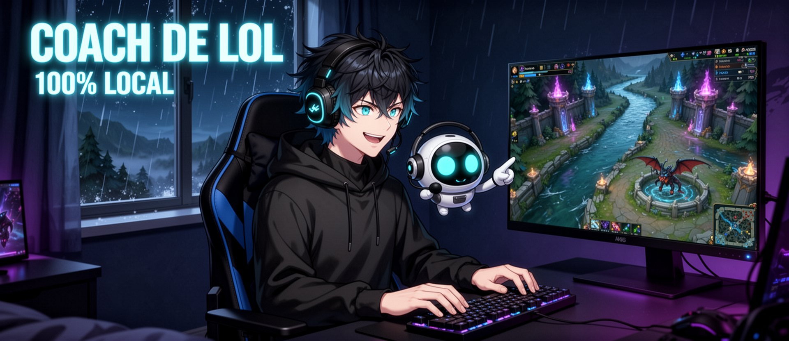
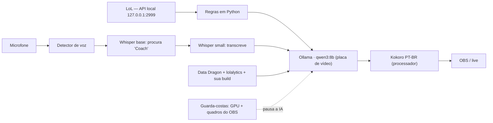
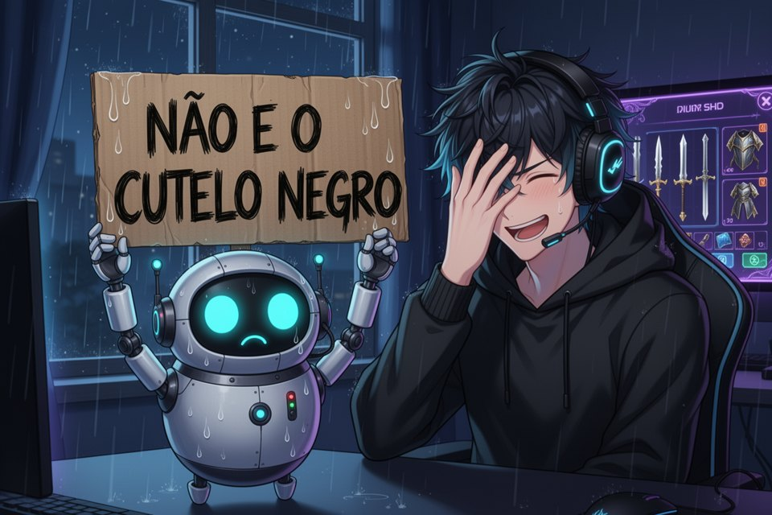

# Coach de LoL 100% local



Coach de voz para League of Legends que roda **inteiro no seu PC**: sem API paga, sem nuvem, sem ler a memória do jogo. É o coach que fala na live do [CanalliTV](https://twitch.tv/canallitv).

- Dá dicas por voz durante a partida: objetivo nascendo, ouro para voltar à base, farm baixo, rival na frente.
- **Conversa**: você diz *"Coach, que item eu faço agora?"* e ele responde em português, com os dados reais da partida.
- Sugere item pela **sua build** (lida do seu histórico) e pelo **meta do patch**, e explica o porquê com os atributos oficiais dos itens.
- A voz sai no áudio do PC, então o OBS já leva o coach para a live.

## Como funciona



A ideia central: **a IA quase não trabalha**. Regras simples em Python geram a maior parte das dicas de graça; o modelo de linguagem só entra para conversar e para uma análise geral a cada ~75 s. Voz e ouvido rodam no processador, deixando a placa de vídeo para o jogo e o OBS.

### Quanto pesa (medido numa live de teste)

| | |
|---|---|
| Uso médio da placa com o coach ligado | 16% |
| Resposta da IA (`qwen3:8b`) | ~1 s |
| Entender "Coach, …" | ~3 s |
| OBS | 60 fps, 2 quadros pulados em 15 min |

Máquina do teste: RTX 5060 Ti 16 GB, Ryzen 7 5700, 32 GB de RAM, live 936p60 com NVENC. O `qwen3:8b` ocupa ~5,3 GB de VRAM; com placa de 8 GB, use `qwen3:4b-instruct` (~2,9 GB) no `config.yaml`.

## Instalação (Windows)

1. Instale o [Ollama](https://ollama.com) e baixe o modelo:
   ```
   ollama pull qwen3:8b
   ```
2. Instale o Python 3.12 e crie o ambiente nesta pasta:
   ```
   python -m venv .venv
   .venv\Scripts\pip install torch --index-url https://download.pytorch.org/whl/cpu
   .venv\Scripts\pip install -r requirements.txt
   ```
   O `torch` é a versão de processador de propósito: a voz não deve disputar a placa com o jogo.
3. Abra o `config.yaml` e ajuste pelo menos `jogador.canal` e `ouvido.microfone` (parte do nome do seu microfone no Windows).
4. (Opcional) Gere a sua build a partir do seu histórico, com o cliente do LoL aberto:
   ```
   .venv\Scripts\python builds.py meus
   ```
   Ou copie `builds.exemplo.yaml` para `builds.yaml` e edite.

Os modelos de voz (Kokoro) e de ouvido (Whisper) são baixados sozinhos na primeira vez.

## Uso

- **Rodar**: `iniciar-coach.bat` (ou `.venv\Scripts\python coach.py`). Ele espera uma partida começar.
- **Testes sem abrir o jogo**:
  - `python coach.py --teste-voz` fala uma frase.
  - `python coach.py --teste-llm` faz uma pergunta à IA com uma partida fictícia.
  - `python coach.py --teste-ouvido` testa o "Coach, …" com frases sintéticas.
  - `python coach.py --simular` roda uma partida fictícia acelerada.
- **Falar com ele**: "Coach, que item eu faço?", "por quê?", "o que faz a Dança da Morte?", "Coach, silêncio" (pausa as dicas por 5 min), "Coach, pode falar".
- **Na tela da live** (opcional): no OBS, crie uma Fonte de Texto lendo `dica_atual.txt`.
- **Botão no Stream Deck do OBS** (opcional): `controle.py` é um serviço local (porta 8767) com `GET /status`, `POST /ligar` e `POST /desligar`. Só aceita pedidos de páginas `file://` com o cabeçalho `X-Deck: 1`. Desligar também tira a IA da memória da placa.
- **Medir o impacto**: `python medir.py 30` grava GPU, VRAM e quadros do OBS por 30 min em `medicao.csv`.

## Arquivos

| Arquivo | O que faz |
|---|---|
| `coach.py` | Loop principal: lê a partida, aplica as regras, chama a IA, fala |
| `live_client.py` | Lê a [Live Client Data API](https://developer.riotgames.com/docs/lol#game-client-api) (a API local oficial do LoL) |
| `rules.py` | Regras de macro (objetivos, ouro, farm, nível) e o resumo da partida para a IA |
| `llm.py` | Conversa com o Ollama; personalidade e regras anti-invenção |
| `voice.py` | Voz Kokoro em PT-BR, com fila de prioridade e intervalo entre falas |
| `ouvido.py` | "Coach, …": detector de voz + Whisper em duas etapas |
| `conhecimento.py` | Itens e campeões oficiais do [Data Dragon](https://developer.riotgames.com/docs/lol#data-dragon), builds e meta |
| `lolalytics.py` | Lê a build do patch no [lolalytics](https://lolalytics.com) (1 página por campeão por patch, em cache) |
| `builds.py` | Gera `builds.yaml` a partir do seu histórico (API local do cliente) |
| `guard.py` | Pausa a IA se a placa de vídeo apertar ou o OBS pular quadros |
| `controle.py` | Serviço para ligar/desligar o coach por um botão |
| `medir.py` | Registra o impacto no PC durante um teste |
| `simulador.py` | Partida fictícia para os testes |
| `config.yaml` | Todas as configurações |

## O que deu errado no caminho (e como resolvemos)

<p align="center"></p>

- **`qwen3:4b` vazava o raciocínio em inglês.** Ele só sabe "pensar"; use `qwen3:4b-instruct` ou `qwen3:8b` com `"think": false`.
- **A IA inventava posição de inimigo.** O prompt deixa claro que ela não vê o mapa e deve dizer isso.
- **Sugeriu Cutelo Negro para Master Yi.** Modelo pequeno não conhece o meta; a sugestão passou a vir da sua build e do meta do patch, com os atributos oficiais.
- **A pausa depois de "Coach" cortava a pergunta.** Ao ouvir só o nome, ele espera a próxima frase por 7 s.
- **"Item" virava "tinha".** O Whisper recebe vocabulário de LoL e os nomes da partida atual como dica.
- **No Treino a rota vem como `"NONE"`.** O caçador é detectado pelo feitiço Golpear.
- **Dicas genéricas repetidas.** A IA vê as últimas dicas e responde `NADA` quando não tem algo concreto.

## Risco de ban

O coach só usa a API local oficial (a mesma de Porofessor, Blitz e Mobalytics). Não lê a memória do jogo, não injeta nada, não usa prints de tela e não mostra informação escondida. Mesmo assim, a Riot não aprova oficialmente coach de IA em tempo real: use por sua conta e, para testar, prefira uma conta secundária. O lolalytics não é uma API oficial; se o site mudar, essa parte para de funcionar e o coach segue com a sua build.

## Créditos

[Ollama](https://ollama.com) · [Qwen3](https://ollama.com/library/qwen3) · [Kokoro-82M](https://huggingface.co/hexgrad/Kokoro-82M) · [faster-whisper](https://github.com/SYSTRAN/faster-whisper) · [Data Dragon](https://developer.riotgames.com/docs/lol#data-dragon) · [lolalytics](https://lolalytics.com)

As imagens deste README foram geradas localmente com Flux 2 na ComfyUI, com o mascote do canal como referência.

*Projeto de fã, sem relação com a Riot Games. League of Legends é marca da Riot Games, Inc.*

Licença: [MIT](LICENSE).
